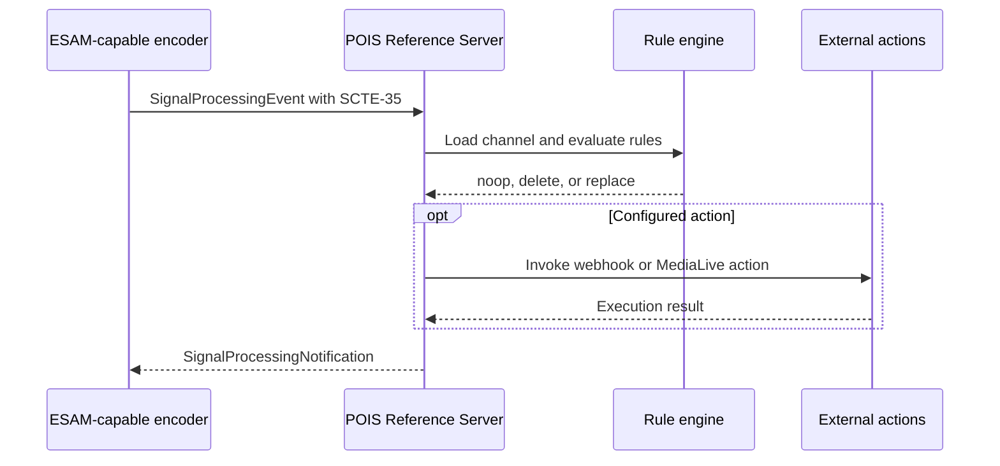
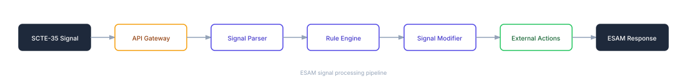

# POIS Reference Server

[](https://github.com/aws-samples/sample-esam-pois-reference-server/actions/workflows/ci.yml)
[](LICENSE)
[](https://www.python.org/)
[](https://nodejs.org/)

A serverless reference implementation of a Placement Opportunity Information
Service (POIS) for conditioning SCTE-35 signals through the ESAM exchange
defined in SCTE-130 Part 9.

The service receives an ESAM `SignalProcessingEvent` from an encoder, evaluates
channel-specific rules, and returns a `SignalProcessingNotification` in the
same request. A web dashboard provides channel configuration, rule management,
user administration, monitoring, and documentation.

> [!IMPORTANT]
> This repository contains sample code for evaluation and development. Review
> its security, availability, latency, and operational controls before using it
> in a production signal path.

## Contents

- [How it works](#how-it-works)
- [Capabilities](#capabilities)
- [Architecture](#architecture)
- [Getting started](#getting-started)
- [Configuration example](#configuration-example)
- [API overview](#api-overview)
- [Local development](#local-development)
- [Testing and quality checks](#testing-and-quality-checks)
- [Security](#security)
- [Cleanup and costs](#cleanup-and-costs)
- [Contributing](#contributing)

## How it works



Rules can pass a signal through, suppress it, or return a modified signal. They
can also trigger optional integrations such as webhooks and AWS Elemental
MediaLive schedule actions.

## Capabilities

| Area | Included functionality |
| --- | --- |
| SCTE-35 processing | Binary and base64 parsing, descriptor inspection, signal modification, and re-encoding |
| Rule engine | Channel-scoped rules, ordered first-match evaluation, compound conditions, and descriptor priority |
| Signal actions | Pass through (`noop`), suppress (`delete`), or modify (`replace`) |
| Stateful processing | Tracks active breaks across requests and suppresses signals while a break is active |
| External actions | Webhooks and AWS Elemental MediaLive schedule actions |
| Virtual Input Switching | Returns alternate-content instructions for compatible ESAM encoders |
| Administration | React dashboard, Amazon Cognito authentication, and `admin`/`user` access levels |
| Observability | Structured logs, CloudWatch dashboards and alarms, action audit records, and AWS X-Ray tracing |

## Architecture



The repository is organized as a monorepo:

| Component | Path | Technology |
| --- | --- | --- |
| Backend | [`backend/`](backend/) | Python 3.12, Pydantic, and AWS Lambda |
| Frontend | [`frontend/`](frontend/) | React 18, TypeScript, Vite, and Tailwind CSS |
| Infrastructure | [`infrastructure/`](infrastructure/) | AWS CDK v2 with TypeScript |
| Documentation | [`docs/`](docs/) | Architecture assets and documentation notes |

The deployed solution uses:

- Amazon API Gateway for ESAM and management endpoints
- AWS Lambda for signal processing and API handlers
- Amazon DynamoDB for configuration, state, preferences, and audit records
- Amazon Cognito for dashboard authentication
- AWS Systems Manager Parameter Store for optional encoder credentials
- Amazon S3 and Amazon CloudFront for the dashboard
- Amazon CloudWatch and AWS X-Ray for observability

## Getting started

### Prerequisites

- An AWS account with permission to create the resources listed above
- AWS CLI v2 configured with valid credentials
- AWS CDK CLI v2
- Python 3.12 or later
- Node.js 20 or later and npm 10 or later
- Internet access to AWS, npm, and PyPI

Before continuing, confirm that `python3 --version` resolves to Python 3.12 or
later. The project `Makefile` uses the `python3` executable when creating its
virtual environment.

Docker is optional. The CDK packages Lambda dependencies with the local
`python3` and `pip`, including Linux x86_64 wheels for native dependencies.
Docker is used only as a fallback if local packaging cannot complete.

### 1. Clone and install

```bash
git clone https://github.com/aws-samples/sample-esam-pois-reference-server.git
cd sample-esam-pois-reference-server
make install
```

The `make install` command creates `backend/.venv` and installs the backend,
frontend, and infrastructure dependencies.

### 2. Select and verify the AWS environment

Set the AWS CLI profile and Region that will own the deployment:

```bash
export AWS_PROFILE=dev
export AWS_REGION=sa-east-1
export AWS_DEFAULT_REGION="$AWS_REGION"

aws sts get-caller-identity
```

Review the returned account before continuing. Stack names default to the
`dev` environment, but the AWS CLI profile can have any name.

### 3. Bootstrap the AWS environment

Run this once for each AWS account and Region:

```bash
ACCOUNT_ID=$(aws sts get-caller-identity --query Account --output text)
cd infrastructure
npx cdk bootstrap "aws://${ACCOUNT_ID}/${AWS_REGION}"
```

Running the command again is safe; an up-to-date bootstrap stack reports no
changes.

### 4. Review and deploy

> [!WARNING]
> Do not omit `adminEmail` for a normal deployment. The infrastructure will
> deploy successfully without it, but the dashboard will have no user and
> Cognito self sign-up is disabled.

```bash
npx cdk diff -c adminEmail=you@example.com
npx cdk deploy --all -c adminEmail=you@example.com
```

The `adminEmail` context value creates the initial administrator. Amazon
Cognito sends that address an invitation with a temporary password. The CDK
uses Cognito's built-in email delivery, so this flow does not require Docker,
an Amazon SES identity, or additional email configuration. The CDK may ask you
to approve IAM changes during deployment; review the displayed changes before
confirming.

For an infrastructure-only deployment, you can omit `adminEmail`. All stacks
will deploy, but no dashboard user will exist and self sign-up remains
disabled. Create a user and add it to the `admin` group before attempting to
sign in.

If you already deployed without `adminEmail`, copy `UserPoolId` from the CDK
outputs and provision the administrator without redeploying:

```bash
export USER_POOL_ID=<USER_POOL_ID>
export ADMIN_EMAIL=you@example.com

aws cognito-idp admin-create-user \
  --user-pool-id "$USER_POOL_ID" \
  --username "$ADMIN_EMAIL" \
  --user-attributes \
    Name=email,Value="$ADMIN_EMAIL" \
    Name=email_verified,Value=true \
    Name=name,Value=Administrator \
  --desired-delivery-mediums EMAIL

aws cognito-idp admin-add-user-to-group \
  --user-pool-id "$USER_POOL_ID" \
  --username "$ADMIN_EMAIL" \
  --group-name admin
```

Cognito sends a new temporary password to `ADMIN_EMAIL`. The first sign-in
requires replacing it with a permanent password.

If the invitation does not arrive, check spam and corporate quarantine, then
generate a new temporary password and resend the message:

```bash
aws cognito-idp admin-create-user \
  --user-pool-id <USER_POOL_ID> \
  --username you@example.com \
  --message-action RESEND \
  --desired-delivery-mediums EMAIL
```

The resend invalidates the previous temporary password.

For non-interactive automation, only after reviewing `cdk diff`, add
`--require-approval never` to the deploy command.

After deployment, the CDK outputs include:

- `FrontendUrl` — dashboard URL
- `ApiUrl` — management API base URL
- `EsamEndpoint` — endpoint configured on the encoder
- `UserPoolId` — Cognito user pool identifier

Open `FrontendUrl` and sign in with the temporary password from the Cognito
invitation. As a basic smoke test, `GET /auth/config` against `ApiUrl` should
return `200`, while an anonymous `GET /channels` should return `401`.

### Deployment options

The default environment is `dev`. Use the `env` context value to deploy another
profile:

```bash
npx cdk deploy --all \
  -c env=staging \
  -c adminEmail=you@example.com
```

Supported profiles are `dev`, `staging`, and `prod`. Stack names follow
`pois-reference-server-<env>-*`, allowing the profiles to coexist in the same
AWS account and Region.

## Configuration example

A channel represents one video source and owns its processing rules:

```json
{
  "channelId": "sports-live-east",
  "name": "Sports Live East",
  "description": "East region sports feed",
  "enabled": true,
  "statefulMode": false,
  "defaultAction": "noop",
  "descriptorPriority": "52,34,48",
  "rules": [
    {
      "ruleId": "cap-long-breaks",
      "name": "Cap breaks longer than 30 seconds",
      "priority": 1,
      "enabled": true,
      "conditions": [
        {
          "field": "segmentationTypeId",
          "operator": "eq",
          "value": 52
        },
        {
          "field": "duration",
          "operator": "gt",
          "value": 30
        }
      ],
      "action": "replace",
      "modifications": [
        {
          "target": "segmentationDuration",
          "operation": "set",
          "value": 30
        }
      ]
    }
  ]
}
```

Rules are sorted by ascending `priority`. Conditions inside a rule are combined
with AND, and the first matching rule determines the action. If no rule
matches, the channel's `defaultAction` is used.

The dashboard contains the complete configuration reference, including
condition fields, operators, modification targets, stateful mode, descriptor
priority, external actions, and Virtual Input Switching.

## API overview

| Method | Endpoint | Purpose | Authentication |
| --- | --- | --- | --- |
| `POST` | `/esam` | Process an ESAM event | Optional per-channel Basic authentication |
| `GET` | `/channels` | List channels | Cognito JWT |
| `POST` | `/channels` | Create a channel | Cognito JWT, `admin` |
| `GET` | `/channels/{id}` | Get channel details | Cognito JWT |
| `PUT` | `/channels/{id}` | Update a channel | Cognito JWT, `admin` |
| `DELETE` | `/channels/{id}` | Delete a channel | Cognito JWT, `admin` |
| `GET` | `/logs` | Query processing logs | Cognito JWT |
| `GET` | `/auth/config` | Load dashboard authentication configuration | Public |

Additional endpoints manage encoder credentials, users, preferences, external
actions, and action audit records. Their full reference is available from the
dashboard's **Documentation** section.

### Connect an encoder

Configure the encoder's ESAM/SCC URI with the `EsamEndpoint` deployment output:

```text
https://<api-id>.execute-api.<region>.amazonaws.com/v1/esam
```

Encoder authentication is configured independently for each channel. When it
is enabled, the service generates credentials and stores the password as a
Parameter Store `SecureString`.

## Local development

The backend runs as Lambda functions. For frontend development, deploy the
backend first and point Vite at the `ApiUrl` deployment output:

```bash
cd frontend
DEV_API_TARGET=https://<api-id>.execute-api.<region>.amazonaws.com/v1 npm run dev
```

The dashboard is available at `http://localhost:3000` with hot reload.

Useful commands:

| Command | Description |
| --- | --- |
| `make install` | Install all dependencies |
| `make build` | Build the frontend and infrastructure packages |
| `make test` | Run the backend test suite with coverage |
| `make lint` | Run backend and frontend checks |
| `make synth` | Synthesize the CDK templates without deploying |
| `make format` | Format the Python backend |

## Testing and quality checks

Before opening a pull request, run:

```bash
make test
make lint
make build
make synth
```

The GitHub Actions workflow runs equivalent checks for the Python backend,
React frontend, and CDK infrastructure.

## Security

- Management endpoints use Cognito JWT validation.
- Authenticated users can read channels and logs.
- Members of the `admin` group manage channels, rules, users, settings,
  external actions, and encoder credentials.
- The `/esam` endpoint can require per-channel HTTP Basic authentication.
- Encoder passwords are generated server-side and stored as Parameter Store
  `SecureString` values.
- DynamoDB data and S3 objects are encrypted at rest, and public traffic uses
  TLS through API Gateway and CloudFront.

Before production use, review MFA enforcement, CORS, API Gateway logging,
removal policies, log retention and content, credential rotation, IAM scope,
failure behavior, and the authentication requirements of the ESAM endpoint.

Report potential vulnerabilities according to [SECURITY.md](SECURITY.md).

## Cleanup and costs

Destroy the same environment profile that you deployed:

```bash
cd infrastructure
npx cdk destroy --all -c env=dev
```

> [!WARNING]
> Cleanup deletes the deployed stacks and their data, including DynamoDB
> tables, Cognito users, and the dashboard bucket. Confirm the selected AWS
> account, Region, and environment before running the command.

AWS charges depend on traffic, stored data, log volume, metrics, alarms, and
the selected Region. CloudWatch resources and retained logs can continue to
incur costs even when request traffic is low. Use the
[AWS Pricing Calculator](https://calculator.aws/) for a workload-specific
estimate.

## Contributing

Contributions are welcome. Read [CONTRIBUTING.md](CONTRIBUTING.md) for the
development workflow, pull request guidance, and code of conduct.

## License

This project is licensed under the MIT No Attribution License. See
[LICENSE](LICENSE).
